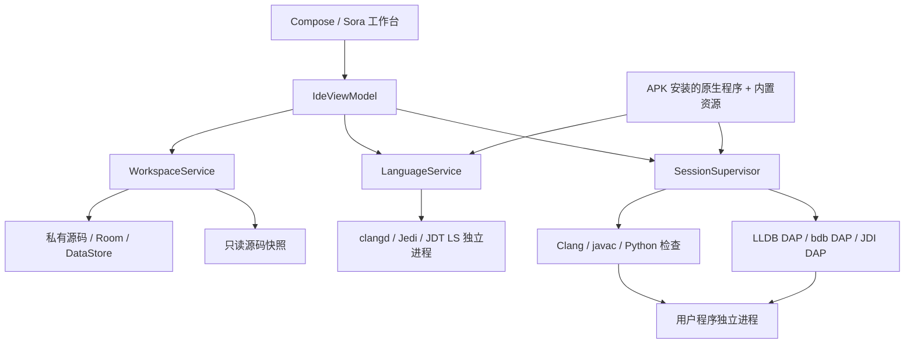

# Mobile Code 首版实现设计

版本：0.1.0 原型；设计基线：用户批准的 v1.0 方案，2026-10-12。本文描述当前工程及其实现边界，验收证据以 VERIFICATION.md 为准。

## 1. 产品与交付

Android 10+、ARM64 的原生手机 IDE，支持 C17、C++17、CPython 3.13 和 Java17 源码/API。全部编译、执行、语义分析和调试在设备上完成。生产 APK 只含 ARM64，开发模拟器可单独构建 x86_64。

采用单个完整 APK，首次在本机解压标准库和语言服务资源。0.2.0根据用户追加要求增加INTERNET与REQUEST_INSTALL_PACKAGES，用于GitHub版本检查、下载和系统确认安装；不申请全部文件访问权限，编程功能仍离线可用。项目默认放在私有存储，通过系统文件选择器导入、导出 ZIP。运行的是控制台项目，完整依赖管理、Android/GUI 工程、Git 和云开发保留为后续功能。更新协议与发布步骤见UPDATES.md。

首版流程：创建项目 → 编写与补全 → 自动保存 → 生成固定源码快照 → 编译 → 运行或调试 → 查看输出、问题或变量 → 导出源码。

## 2. 页面与编辑

首页提供最近项目、语言过滤、单文件/多文件模板和 ZIP 导入。工作台由文件标签、Sora 编辑区、快捷符号栏和可折叠、可调高度的底部面板组成。窄屏使用文件抽屉，宽屏固定显示文件列表。

编辑器支持行号、括号补齐、缩进、Tree-sitter 高亮、源码不变的折叠、撤销重做、多文件标签、搜索替换、字体和换行设置。IME 组合输入由 Sora InputConnection 处理；界面测试使用真实组合输入 API 验证中文和 emoji。

底部面板区分编译日志、stdout、stderr，以及问题、栈帧、变量和观察项。交互输入按行发送，可显式 EOF；预置输入发送完后关闭管道。无需完整终端模拟器。

断点以空心、实心和划线符号区分待验证、有效及无法绑定。调试器返回实际绑定行；调试时编辑器只读，普通运行时可继续编辑。运行诊断始终保留快照位置，当前文本不同时打开快照预览。

## 3. 模块与进程

| 实现入口 | 职责 |
|---|---|
| `MobileCodeApp` | 应用级服务和协程作用域，组件准备，低内存语言索引回收 |
| `IdeViewModel` | 文档状态、自动保存、项目切换、导航、调试与观察交互 |
| `WorkspaceService` | 原子保存、模板、导入导出、Room 元数据、快照 |
| `MobileLanguage` / `NativeSyntax` | Sora 补全桥接、增量 Tree-sitter、高亮和折叠范围 |
| `LanguageService` | LSP 初始化、文档同步、补全、签名、诊断和有限重启 |
| `ToolchainService` | 资源 SHA256、原生组件 SHA256、解压和安装目录别名 |
| `BuildService` | 参数数组编译、统一诊断、入口发现、只读共享库产物 |
| `SessionSupervisor` | 单会话状态机、独立 I/O、DAP、停止、超时和资源监控 |
| `SessionForegroundService` | 用户主动执行任务的前台通知与停止入口 |
| `mc_process` / `mc_runner` | posix_spawn、管道、Unix FD、进程组、Python/JVM/native 入口 |

用户代码崩溃不会直接终止编辑器进程。但这些进程属于同一应用 UID，不能作为恶意代码安全沙箱。导入和打开项目不会执行项目代码。

## 4. 语言执行与调试

### C / C++

按 sourceRoots 搜集项目源码；C 源文件使用 C17，C++ 源文件使用 C++17。Clang 输出 PIC 对象，LLD 链接 `libuser_program.so`，要求唯一标准 `main`，检查导出符号后设为只读。

编译使用 Android29 目标、APK 标准库/sysroot、`-g -O0 -fno-omit-frame-pointer` 和 16KB 页链接设置。libc++ 头文件必须排在 C 头文件前面。输出诊断的 UTF-8 字节列转换为 UTF-16。

APK 安装目录中的 `libmc_runner.so` 是实际 ELF 启动器，通过 dlopen 加载用户共享库、解析 `main` 并传递 argc/argv；不从可写目录直接执行生成的 ELF。LLDB DAP 在加载模块前保留断点，模块加载后实际绑定。启动器的 native-debug 模式直接连接会话私有 FIFO 控制台，并写入真实连接完成标记后才允许发送输入；控制参数不会传入用户 argc/argv。这样不依赖调试器继承额外描述符或支持特定 stdio 扩展。DAP 和原生调试协议仍使用独立本地通道，不开放 TCP。

### Python

每次启动独立运行器进程，加载 CPython 3.13.12，设置独立 home、项目搜索路径和会话工作目录。禁止源码快照生成 pycache。Android 嵌入式 Python 默认日志流被显式恢复为真正的控制台管道。

`mobilecode_python.py` 提供编译检查、运行、Jedi LSP 和 bdb DAP。DAP 使用独立 Unix socket FD，主线程执行用户代码、后台命令线程处理调试请求。主线程支持断点、继续、进入、跳过、跳出、暂停、栈和局部变量；暂停在解释器可响应的位置生效。

观察表达式通过 AST 检查和静态属性访问读取变量、字段或固定下标，不提供赋值或函数调用。变量显示避免调用用户自定义 repr。Python 子线程可以运行，首版不承诺专门的多线程调试。

### Java

应用 UI 由 Android ART 承载，用户程序、JDT LS、调试适配器各使用独立 OpenJDK21 JVM。Java 编译服务调用 javac API，使用 `--release 17 -g -encoding UTF-8`，仅编译配置的源码根。编译结果检测可运行入口类；多个入口由运行配置指定完整类名。

Android OpenJDK 上游按 dladdr 返回的 libjvm 位置推导标准库路径。APK 原生目录是平铺结构，因此运行器对 libjvm 的该项查询返回逻辑 `JAVA_HOME/lib/server/libjvm.so` 别名；实际 ELF 仍来自只读 APK 安装目录。这一适配已通过真机运行和 JDI 调试验证。

用户 JVM 开启自定义 `dt_mobile` JDWP transport，将协议通过继承 Unix FD 交给 JDI Connection。JavaDebugAdapter 把 ClassPrepare、Breakpoint 和 StepEvent 转换成 DAP，不开放 TCP 端口。观察项读取 JDI 字段和数组，不调用目标方法。

## 5. 代码智能与位置

高亮在语言服务启动前可用。基础补全由关键字、片段和文档标识符组成；语义补全分别由 clangd、Jedi、JDT LS 提供，支持项目其他文件中的符号和签名。

文档变更带版本号，补全响应应用前再次核对版本和文件。高亮、折叠和括号匹配也带文档代数与行数，主线程安装结果前再次校验，防止快速切换时应用旧样式；释放后的编辑器拒绝排队导航。普通 LSP 请求超过 2 秒取消，Java 首次索引期间允许下一次请求重试。语言服务退出会有限重启；一分钟内三次崩溃暂停自动重启。界面保留高亮与基础补全。

内部位置使用零起始行与 UTF-16 列。LSP 请求声明 UTF-16；DAP 适配器转换为一开始的行列。项目和快照使用规范路径，统一 Android `/data/user/0` 与 `/data/data` 别名，避免有效栈帧或诊断被误判为外部文件。

## 6. 数据一致性

源码和 project.json 是事实来源。保存流程为同目录临时文件 → fd.sync → 原子替换；失败时保留脏文档。Room 保存项目索引、断点和会话历史，DataStore 保存编辑设置和位置。源文件提交后更新元数据，启动时扫描校对；旧运行历史仅在启动恢复阶段标为中断。

500ms 输入空闲后保存，切换、后台、运行和调试前立即刷新。源码快照按会话隔离，带文件哈希和项目配置；运行产物写入会话工作目录，不自动覆盖项目。快照文件只读用于保持正常工作流一致，不构成同 UID 恶意代码的写保护边界。

导入 ZIP 校验相对路径，拒绝越界，限制数量和总大小。配置缺失的可选字段按版本默认值补齐。导出只包含项目源码、资源和配置，不包含工具链、语言缓存或编译产物。

## 7. 会话、通信与资源

运行状态：准备 → 快照 → 构建 → 启动 → 运行 → 结束/失败/取消。调试增加运行/暂停切换。状态来自实际进程和协议事件，重复 operation ID 返回同一会话。

LSP/DAP 使用 Content-Length JSON 帧。用户输出使用独立管道、持续排空；内存显示保留尾部，磁盘日志最多 10MB。取消前先终止相关进程，让阻塞的读写返回，再完成协程和句柄清理。用户副作用不会自动重试。

| 限制 | 设置 |
|---|---|
| 同时运行/调试 | 1 个 |
| 构建进程 | 默认 120 秒 |
| 运行 | 项目配置 1～600 秒，默认60秒，含等待 stdin |
| 调试暂停 | 不累计执行超时 |
| Java 用户堆 | 默认 256MB |
| 运行进程 RSS | 初始512MB；构建阶段允许更高预算 |
| 控制台磁盘日志 | 10MB，之后继续排空管道 |
| 会话生成文件 | 默认100MB，并限制文件数 |

前台服务使用 Android14+ specialUse 类型；Android13+ 在首次运行通知时申请通知权限。语言服务按需启动，低内存时优先关闭可重建索引。

## 8. 工具链、构建与风险

Android/Bionic 组件随 APK 安装。头文件、JAR、标准库和配置放在离线 ZIP；执行程序、共享库和 Python 扩展作为 native libraries 安装。打包器重写 SONAME/NEEDED/RUNPATH，并为同名组件分配唯一文件名，避免 Python3.13/3.14 的稳定 ABI 库互相覆盖。

原生依赖版本与 SHA256 冻结在 tools/locks；JDT LS、CPython、Gradle 的关键归档固定 SHA256。上游原生库逐项验证 16KB LOAD 对齐；不兼容的 spawn 库从固定源码重编。真实 16KB 设备执行仍需独立验证。

当前小米9SE上的功能通过不等于 Android10～17 全矩阵通过。性能分位数、厂商后台回收、低内存极限、升级和实际16KB设备仍需覆盖。当前 APK 使用本机开发证书、应用调试标志关闭；公开发布签名和完整对应源码材料见 BUILD.md 与 SOURCE_MATERIALS.md。

## 9. 验证入口

主机：verification/test_runtime.py，验证真实原生运行、Python 和 Java 私有 FD 调试。

真机：OfflineIdeTest 验证四语言运行、进入/跳过/跳出、栈、局部变量、观察、语义补全、输入/EOF、幂等启动、崩溃、超时、输出限制；WorkbenchTest 验证真实 Sora/Compose 编辑交互和四语法增量解析。

产物：tools/audit_apk.py 逐项检查 APK 的 ABI、原生 SHA256、唯一名称、全部 ELF 对齐、离线资源校验、必要资产和体积；Android SDK 工具另行核对 manifest 和签名。结果和未验证项目写入 VERIFICATION.md，不把构建成功当作设备验收。
